# UrbanFix — Context Map

**Proyecto:** UrbanFix — Aplicación móvil para el reporte de problemáticas urbanas
**Ámbito:** Ciudades y localidades urbanas (contexto de referencia: Bogotá D.C.)
**Asignatura:** Arquitectura de Software — Universidad de Bogotá Jorge Tadeo Lozano
**Autores:** Johan Felipe Aguilar Castillo · Samuel Alejandro González Grajales · Juan David Barragán
**Módulo:** 5 — Semana 9 · Dominio y fronteras
**Documentos previos:** [subdominios.md](./subdominios.md) · [responsabilidades-contextos.md](./responsabilidades-contextos.md) · [07](../07-c4-componentes.md) · [ADR 0001](../../adrs/0001-decision-estilo.md)
**Fuente:** Elaboración propia a partir del código del backend (`backend_urbanfix_Architecture`), del cliente Android (`UrbanFix_Architecture`), de los documentos 01–07 y de los ADR 0001–0002.

> El Context Map muestra **qué responsabilidad protege cada contexto** y **qué se piden entre ellos**,
> en lenguaje del negocio. La evidencia en el código de cada contexto y de cada relación está en
> [responsabilidades-contextos.md](./responsabilidades-contextos.md); los identificadores `REL-xx` son
> los mismos en ambos documentos.

---

## 1. Diagrama

```mermaid
%%{init: {"flowchart": {"wrappingWidth": 340, "nodeSpacing": 60, "rankSpacing": 90}}}%%
flowchart LR
    ciudadano(["👤 Ciudadano"])
    funcionario(["👤 Funcionario de una entidad"])

    identidad("<b>Identidad y Acceso</b><br/><i>genérico</i><br/>───────────<br/><small>Sabe <b>quién es</b> cada actor y <b>con qué rol</b> actúa:<br/>registra cuentas, autentica y gestiona el perfil</small>")

    reportes("<b>Gestión de Reportes</b><br/><i>núcleo</i><br/>───────────<br/><small>Protege el <b>reporte y su ciclo de vida</b>:<br/>lo crea con ubicación, fotos, categoría y subtipo,<br/>lo muestra (lista, detalle, mapa, mis reportes)<br/>y registra el estado que declara la entidad<br/>Nuevo → En proceso → Resuelto</small>")

    validacion("<b>Validación Ciudadana</b><br/><i>soporte</i><br/>───────────<br/><small>Produce la <b>señal comunitaria</b> de que un reporte es real:<br/>apoyos (like), denuncias (dislike) y comentarios.<br/>Un actor, una reacción por reporte</small>")

    institucional("<b>Gestión Institucional</b><br/><i>soporte</i><br/>───────────<br/><small>Sabe <b>qué entidades existen</b> (IDU, UAESP, EAAB…)<br/>y <b>qué funcionarios</b> actúan en nombre de cada una.<br/>Los funcionarios se inscriben por sí mismos</small>")

    catalogos("<b>Catálogos de Clasificación</b><br/><i>soporte</i><br/>───────────<br/><small>Define <b>qué categorías de daño</b> son válidas<br/>(huecos, alumbrado, basura, semáforos,<br/>hidrantes, alcantarillas)</small>")

    ciudadano -.->|"crea y consulta reportes"| reportes
    ciudadano -.->|"apoya, denuncia y comenta"| validacion
    funcionario -.->|"marca En proceso / Resuelto"| reportes
    funcionario -.->|"se inscribe en su entidad"| institucional

    reportes -->|"REL-01 · pregunta quién creó el reporte<br/>REL-02 · verifica que quien cambia el estado<br/>tiene rol de funcionario"| identidad
    reportes -->|"REL-03 · registra qué funcionario<br/>de la entidad tomó el reporte"| institucional
    reportes -->|"REL-04 · clasifica el reporte<br/>con una categoría válida"| catalogos
    reportes <-->|"REL-06 · muestra el respaldo comunitario del reporte<br/>REL-07 · solo se reacciona o comenta sobre un reporte existente<br/><b>relación bidireccional</b>"| validacion
    validacion -->|"REL-08 · identifica a quien reacciona o comenta<br/>para aplicar una reacción por actor"| identidad
    validacion -->|"REL-09 · reconoce si el autor es funcionario<br/>(insignia 'verificado')"| institucional
    identidad <-->|"REL-10 · Identidad autentica al funcionario;<br/>Institucional sabe a qué entidad representa<br/><b>comparten el modelo Funcionario</b>"| institucional

    classDef nucleo fill:#FFF2CC,stroke:#B7950B,stroke-width:2px,color:#000
    classDef generico fill:#DAE8FC,stroke:#2E6295,stroke-width:2px,color:#000
    classDef soporte fill:#D5E8D4,stroke:#4D7C3F,stroke-width:2px,color:#000
    classDef actor fill:#F4F4F4,stroke:#777777,color:#000

    class reportes nucleo
    class identidad generico
    class validacion,institucional,catalogos soporte
    class ciudadano,funcionario actor

    linkStyle 0,1,2,3 stroke:#999999,stroke-dasharray:4 4
    linkStyle 7 stroke:#C0392B,stroke-width:2.5px
```

| Elemento | Significado |
|---|---|
| Caja amarilla | Contexto **núcleo**: la razón de ser de UrbanFix. |
| Caja azul | Contexto **genérico**: resuelto en cualquier sistema. |
| Caja verde | Contexto de **soporte**: propio del negocio, pero no diferencial. |
| Flecha gris punteada | Qué hace cada actor y en qué contexto lo hace. |
| Flecha `A → B` | A necesita algo que solo B puede responder. |
| Flecha `A ↔ B` | Relación bidireccional: cada uno necesita algo del otro. |
| Flecha roja | Dependencia en ciclo entre Reportes y Validación Ciudadana. |

---

## 2. Responsabilidad que protege cada contexto

| Contexto | Responsabilidad que protege | Por qué no pertenece a su vecino |
|---|---|---|
| **Gestión de Reportes** (núcleo) | El reporte y su ciclo de vida visible: cómo se crea, cómo se muestra y en qué estado está. Solo la entidad, a través de su funcionario, cambia el estado. | Un like no cambia el reporte (Validación). El reporte sabe qué funcionario lo tomó, no cómo se organiza la entidad (Institucional). Usa una categoría, no la define (Catálogos). |
| **Identidad y Acceso** (genérico) | Quién es cada actor y con qué rol actúa. | Que un funcionario cambie de entidad no cambia sus credenciales (Institucional). Los demás contextos solo necesitan saber quién actúa, no cómo se autenticó. |
| **Validación Ciudadana** (soporte) | La señal comunitaria de que un reporte es real. | La señal es informativa: no oculta, no prioriza ni cambia el estado del reporte (Reportes). |
| **Gestión Institucional** (soporte) | Qué entidades existen y qué funcionarios actúan en nombre de cada una. | Pertenecer a una entidad es un hecho institucional, no una credencial (Identidad). La atención interna de cada entidad ocurre en su propio sistema, fuera de UrbanFix. |
| **Catálogos de Clasificación** (soporte) | Qué categorías de daño son válidas. | Agregar una categoría no cambia cómo se crea ni se atiende un reporte (Reportes). El subtipo no vive aquí: es texto del reporte. |

---

## 3. Relaciones entre contextos

| ID | Relación | Qué necesita y por qué |
|---|---|---|
| REL-01 | Reportes → Identidad | Saber **quién creó** el reporte para mostrarlo y para "mis reportes". |
| REL-02 | Reportes → Identidad | Confirmar que **quien cambia el estado es un funcionario**. Hoy el rol lo declara la app sin verificación. |
| REL-03 | Reportes → Institucional | Registrar **qué funcionario** tomó el reporte, y con ello a qué entidad pertenece. |
| REL-04 | Reportes → Catálogos | **Clasificar** el reporte con una categoría válida. |
| REL-06 | Reportes → Validación | **Mostrar el respaldo comunitario** (cuántos apoyos y denuncias tiene) junto al reporte. |
| REL-07 | Validación → Reportes | Solo se puede reaccionar o comentar **sobre un reporte que existe**. Con REL-06 forma un ciclo. |
| REL-08 | Validación → Identidad | Saber **quién reacciona o comenta**, para aplicar "una reacción por actor". |
| REL-09 | Validación → Institucional | Reconocer si el autor de un comentario es **funcionario**, para mostrarlo como verificado. |
| REL-10 | Identidad ↔ Institucional | El funcionario tiene **credenciales** (Identidad) y **entidad** (Institucional). Hoy ambos datos están en el mismo modelo `Funcionario`. |

Todas estas relaciones son hoy llamadas dentro del mismo backend Flask, sobre una base de datos
compartida ([ADR 0001](../../adrs/0001-decision-estilo.md)). La flecha indica qué necesita un
contexto del otro, no una llamada por red.

---
