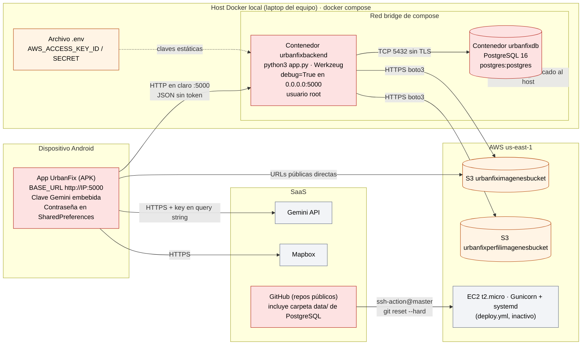
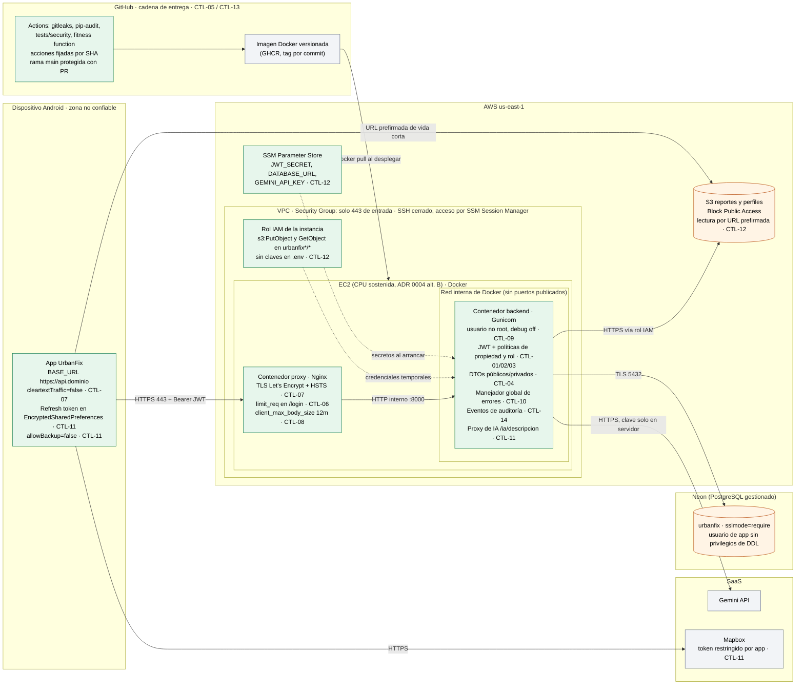

# 08 · Diagrama de despliegue y costo relativo de alternativas

**Autores:** Johan Felipe Aguilar Castillo · Samuel Alejandro González Grajales · Juan David Barragán

**Relación con otros documentos:** los controles CTL-xx vienen de [03-matriz-riesgos-controles.md](./03-matriz-riesgos-controles.md);
la topología base respeta el [ADR 0004](../../adrs/0004-decision-distribucion.md) (monolito sin distribuir, crecimiento por
la vía **B → C**). Este documento no cambia esa decisión: ubica los controles de seguridad sobre ella y compara cuánto cuesta
cada forma de desplegarlos.

---

## 1. Despliegue actual (as-is)

Es el montaje que hoy existe en el repositorio: Docker local con el servidor de desarrollo, y el despliegue EC2 de
`deploy.yml`, documentado pero **inactivo** según el README. En rojo, los nodos y conexiones donde la matriz encontró
riesgos críticos o altos.

**Lectura:** el borde de Internet llega directo al proceso Flask; no hay nodo entre la app y el backend donde aplicar TLS,
límites de tasa o tamaño de petición. Por eso la mayoría de controles de borde (CTL-06, CTL-07, CTL-08) necesitan un nodo
nuevo en el despliegue.

---

## 2. Despliegue objetivo con controles de seguridad (to-be)

Corresponde a la **alternativa B del ADR 0004** (una instancia, Gunicorn, `debug=False`) más los controles de este módulo.
Se dibuja con la opción de menor costo para cada control (paquete **P1**, §4). Las etiquetas `CTL-xx` indican qué control
vive en cada nodo o conexión.

### Qué cambia y por qué

| Nodo o conexión | Antes | Después | Controles | Riesgos que reduce |
|---|---|---|---|---|
| App → API | HTTP en claro a `:5000`, identidad en el body | HTTPS 443 con Bearer JWT | CTL-01, CTL-07 | SEG-01, SEG-07 |
| Nodo de borde | No existe | Contenedor Nginx: TLS, `limit_req`, límite de cuerpo | CTL-06, CTL-07, CTL-08 | SEG-06, SEG-07, SEG-08 |
| Proceso backend | Werkzeug `debug=True`, root, `0.0.0.0` | Gunicorn sin depurador, usuario no root, solo red interna | CTL-09 | SEG-09 |
| Lógica de la API | Sin verificación de identidad ni de dueño | JWT, políticas de propiedad, rol y entidad, DTOs, errores genéricos, auditoría | CTL-01 a CTL-04, CTL-10, CTL-14 | SEG-01 a SEG-04, SEG-10, SEG-14 |
| Base de datos | `postgres:postgres`, puerto publicado, datos en el repo | Neon con TLS, sin puertos publicados, `data/` fuera del repo | CTL-05 | SEG-05 |
| Credenciales AWS | Claves estáticas en `.env` | Rol IAM de la instancia | CTL-12 | SEG-12 |
| Secretos de la app | `.env` y código del APK | SSM Parameter Store, leídos al arrancar | CTL-11, CTL-12 | SEG-11, SEG-12 |
| Imágenes | Buckets con URLs públicas | *Block Public Access* + URLs prefirmadas | CTL-12 | SEG-04, SEG-12 |
| Gemini | Llamada directa desde el APK | Llamada desde el backend, autenticada y limitada | CTL-11 | SEG-11 |
| Entrega | `ssh-action@master` + `git reset --hard` | Imagen versionada construida tras pasar gitleaks, pip-audit y pruebas | CTL-05, CTL-13 | SEG-05, SEG-13 |

**Zero Trust en el despliegue:** ningún nodo confía en otro por estar en la misma red. La API valida el token aunque la
petición venga del proxy, la BD exige TLS aunque el backend esté en AWS, y las credenciales AWS son temporales y acotadas
a dos buckets.

**Lo que este diagrama no resuelve:** sigue habiendo una sola instancia (punto único de falla, F-12 del ADR 0004). La
alternativa C del ADR 0004 añade un ALB y un segundo nodo; ver §4.3 para cómo cambia el costo de los controles en ese caso.

---

## 3. Alternativas por control

Para cada decisión de despliegue hay al menos dos formas de implementar el control. Se usa la misma convención del
ADR 0004: costo en **órdenes de magnitud** en tres dimensiones (infraestructura, operación y coordinación), más la factura
estimada en USD/mes para anclar la primera.

**Línea base de costo:** alternativa B del ADR 0004 ≈ **19 USD/mes** (1 `t3.small` + IPv4 + Neon Free). Los índices se
expresan como el costo **adicional** frente a esa base.

### 3.1 Borde: TLS, límite de tasa y tamaño de petición (CTL-06, CTL-07, CTL-08)

| Alternativa | Infra adicional (USD/mes) | Operación | Ventaja | Desventaja |
|---|---|---|---|---|
| **a. Nginx + Let's Encrypt en la misma EC2** | ≈ 0 | O(1): un contenedor más, renovación automática del certificado con certbot | Sin costo; el límite de tasa se aplica antes de gastar CPU en `scrypt` | El certificado y el proxy los opera el equipo; comparte CPU con el backend |
| b. ALB + certificado ACM | ≈ 22 (16,4 fijo + 1 LCU ≈ 5,8) | O(1): certificado gestionado por AWS | Certificado sin renovación manual; es el mismo ALB que exige la alternativa C | El ALB no hace limitación de tasa por sí solo: sigue haciendo falta Nginx o WAF para CTL-06 |
| c. ALB + ACM + AWS WAF con regla de tasa | ≈ 22 + 5 (web ACL) + 1 por regla + 0,60 por millón de peticiones ≈ **31** con 4 reglas y ~1 M peticiones | O(10): reglas, falsos positivos y registros que alguien debe revisar | Limitación de tasa y reglas gestionadas fuera del proceso; bloquea antes de llegar a la EC2 | El costo crece con cada regla; sin monitoreo el WAF se vuelve una caja negra |

### 3.2 Gestión de secretos (CTL-11, CTL-12)

| Alternativa | Infra adicional (USD/mes) | Operación | Ventaja | Desventaja |
|---|---|---|---|---|
| `.env` en el servidor (actual) | 0 | O(1) | Simple | Secretos en disco, sin rotación ni registro de acceso |
| **a. SSM Parameter Store (estándar, SecureString)** | ≈ 0 (nivel estándar sin cargo por parámetro, *aprox., no verificado en esta sesión*) | O(1): el backend lee los parámetros al arrancar con el rol IAM | Cifrado con KMS, permisos IAM y auditoría en CloudTrail | La rotación es manual |
| b. AWS Secrets Manager | ≈ 0,40 por secreto + 0,05 por 10.000 llamadas ≈ **1,6** con 4 secretos | O(1) | Rotación automática (útil para la credencial de BD) | Costo por secreto; poco valor extra con 4 secretos y sin rotación de Neon integrada |

### 3.3 Identidad y autenticación (CTL-01, CTL-03)

| Alternativa | Infra adicional (USD/mes) | Operación y desarrollo | Ventaja | Desventaja |
|---|---|---|---|---|
| **a. JWT propio en Flask (PyJWT / flask-jwt-extended)** | 0 | O(10) horas de desarrollo; el equipo custodia la clave de firma y la lógica de *refresh* | Reutiliza los hashes `scrypt` actuales; sin dependencia externa; sin cambios en la topología | Errores de implementación (expiración, revocación) quedan en manos del equipo |
| b. Amazon Cognito (Lite o Essentials) | 0 hasta 10.000 MAU; después ≈ 0,0055 (Lite) a 0,015 (Essentials) por MAU | O(10)–O(100): SDK en Android, migración de usuarios, cambio de flujo de login y de roles | MFA, recuperación de contraseña y bloqueo de cuentas gestionados | Los hashes `scrypt` no se importan: exige restablecer contraseñas o un disparador de migración; añade un límite de confianza nuevo y acopla el login a AWS |

### 3.4 Credenciales hacia S3 y entrega de imágenes (CTL-12)

| Alternativa | Infra adicional (USD/mes) | Operación | Ventaja | Desventaja |
|---|---|---|---|---|
| Claves IAM estáticas + URLs públicas (actual) | 0 | O(1) | Simple | Claves de larga duración; objetos legibles por cualquiera |
| **a. Rol IAM de instancia + URLs prefirmadas** | 0 | O(1): política IAM y una llamada `generate_presigned_url` | Credenciales temporales; objetos privados | Las URLs prefirmadas compartidas valen hasta expirar; la app debe pedir URL nueva al recargar |
| b. CloudFront con OAC delante de S3 | No cuantificado (depende de transferencia; no se consultó precio) | O(10): distribución, política de bucket, invalidaciones | Caché y menor latencia de imágenes | Otro servicio que operar sin necesidad medida en el piloto |

### 3.5 Cadena de entrega (CTL-05, CTL-13)

| Alternativa | Infra adicional (USD/mes) | Operación | Ventaja | Desventaja |
|---|---|---|---|---|
| **a. gitleaks + pip-audit + Dependabot + protección de rama en GitHub Actions** | 0 en repositorios públicos | O(1): tres pasos de workflow y una regla de rama | Bloquea secretos y dependencias vulnerables antes de desplegar | Requiere disciplina de PR en un equipo de 3 |
| b. Escáner comercial (SAST/DAST de pago) | No cuantificado | O(10) | Más cobertura | Sin presupuesto en el proyecto (01 §2) |

---

## 4. Costo relativo de los paquetes

Se agrupan las alternativas en tres paquetes coherentes. En todos, CTL-02, CTL-04, CTL-09, CTL-10 y CTL-14 cuestan lo mismo
(solo código, sin infraestructura), por eso no diferencian.

### 4.1 Composición

| Paquete | Borde | Secretos | Identidad | S3 | Entrega |
|---|---|---|---|---|---|
| **P1 · Mínimo autogestionado** | Nginx + Let's Encrypt | SSM Parameter Store | JWT propio | Rol IAM + prefirmadas | gitleaks, pip-audit, Dependabot |
| P2 · Borde gestionado | ALB + ACM (+ Nginx para tasa) | Secrets Manager | JWT propio | Rol IAM + prefirmadas | igual que P1 |
| P3 · Todo gestionado | ALB + ACM + WAF | Secrets Manager | Cognito | Rol IAM + CloudFront | igual que P1 |

### 4.2 Costo en tres dimensiones (alternativa B del ADR 0004, una instancia)

| Paquete | ≈ USD/mes total | Índice frente a la base (19 USD) | Infraestructura | Complejidad operativa | Coordinación del equipo |
|---|---|---|---|---|---|
| Sin controles (hoy) | ≈ 19 | 1,0× | O(1) | O(1) | O(1) |
| **P1** | ≈ 19 | **1,0×** | O(1) | O(1): un contenedor de proxy y un certificado | O(1): un repo, un artefacto |
| P2 | ≈ 43 (19 + 22 ALB + 1,6 secretos) | ≈ 2,3× | O(10) bajo | O(1)–O(10): ALB, *health check*, dos sitios de configuración del borde | O(1) |
| P3 | ≈ 52 o más (P2 + ≈ 9 WAF + CloudFront sin cuantificar; Cognito 0 hasta 10.000 MAU) | ≈ 2,8× o más | O(10) | O(10): reglas de WAF, *user pool*, distribución de CloudFront | O(10): el login depende de un servicio externo y de migrar a todos los usuarios |

**Lectura:** la factura no separa a P1 de los otros paquetes; los separa la operación y, en P3, la migración de identidad.
P1 cubre los 14 controles con costo de infraestructura adicional ≈ 0 y no cambia la topología del ADR 0004.

### 4.3 Si se activa la alternativa C del ADR 0004 (2 nodos + ALB)

La alternativa C ya paga el ALB (≈ 72 USD/mes en el ADR 0004). En ese escenario el costo **marginal** de terminar TLS en
el ALB con ACM es ≈ 0, y P2 pasa a ser la opción natural:

| Paquete sobre la alternativa C | ≈ USD/mes total | Costo marginal de seguridad | Comentario |
|---|---|---|---|
| P1 (Nginx en cada nodo) | ≈ 72 | ≈ 0 | Dos certificados y dos proxies que mantener sincronizados: peor que P2 aquí |
| **P2** | ≈ 74 | ≈ 1,6 | TLS en el ALB; el límite de tasa debe coordinarse entre nodos (Nginx por nodo o almacén compartido) |
| P3 | ≈ 83 o más | ≈ 11 o más | El WAF resuelve la tasa de forma global entre nodos; justificado solo si se observan ataques distribuidos |

### 4.4 Recomendación

1. **Ahora (alternativa B): P1.** Cubre todos los controles con ≈ 0 USD/mes adicionales y operación O(1).
2. **Si se activa C:** migrar el borde a **P2** (TLS en el ALB que ya se paga) y mantener JWT propio y SSM.
3. **WAF y Cognito solo con evidencia:** WAF si el registro de CTL-14 muestra ataques distribuidos que el límite por IP no
   frena; Cognito si se exige MFA o federación con cuentas institucionales.

---

## 5. Supuestos del cálculo

| Supuesto | Valor | Si cambia… |
|---|---|---|
| Tráfico del piloto | ≈ 1 millón de peticiones/mes | El costo de WAF (0,60 USD por millón) crece linealmente; los demás paquetes no cambian |
| Usuarios activos mensuales | < 10.000 MAU | Por encima, Cognito pasa a costar ≈ 0,0055–0,015 USD por MAU |
| Secretos gestionados | 4 (JWT, BD, Gemini, Mapbox de servidor) | Secrets Manager suma 0,40 USD por secreto adicional |
| Precios de EC2, ALB, IPv4 y Neon | Los del ADR 0004 (consultados el 2026-10-23) | Recalcular la base y los índices |
| Precios de Secrets Manager, WAF y Cognito | Consultados el 2026-11-06 en las páginas oficiales de AWS | — |
| SSM Parameter Store estándar sin cargo | Conocimiento previo, **no verificado en esta sesión** | Verificar en la página de precios de AWS Systems Manager antes de entregar |

## Fuentes

- [AWS Secrets Manager — Pricing](https://aws.amazon.com/secrets-manager/pricing/) (consultado 2026-11-06)
- [AWS WAF — Pricing](https://aws.amazon.com/waf/pricing) (consultado 2026-11-06)
- [Amazon Cognito — Pricing](https://aws.amazon.com/cognito/pricing/) (consultado 2026-11-06)
- EC2, ALB, IPv4 y Neon: fuentes listadas en la sección Trazabilidad del [ADR 0004](../../adrs/0004-decision-distribucion.md)
