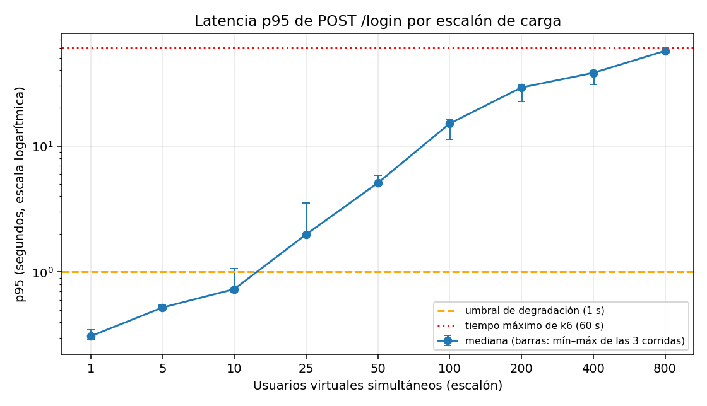
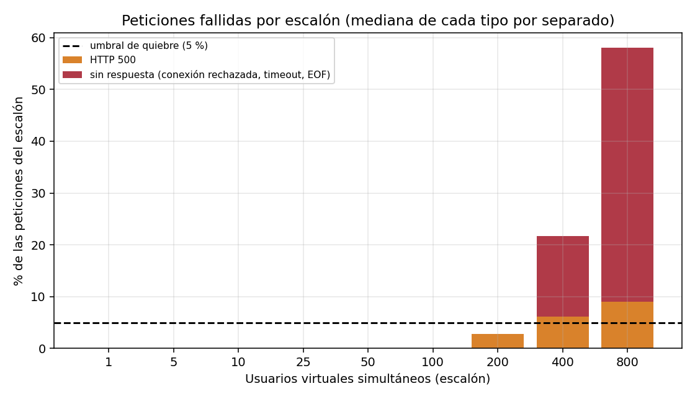
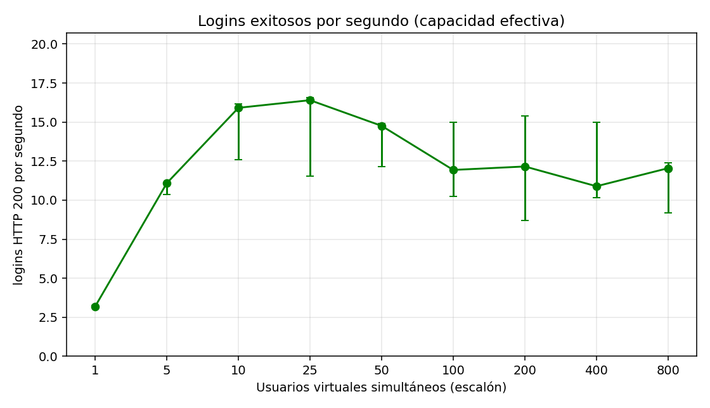
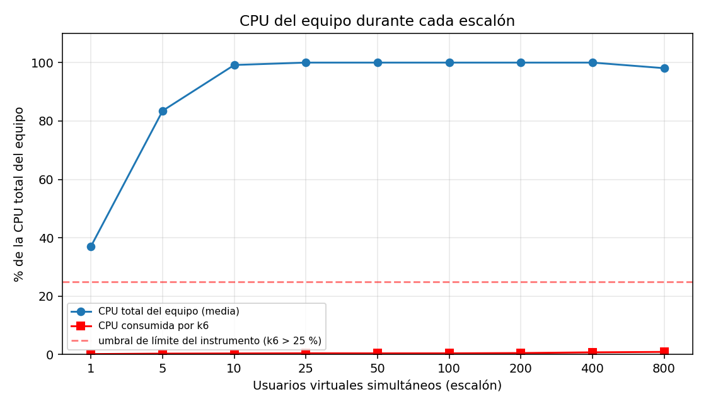

# Experimento E3 — Crecimiento de carga en `POST /login`: dónde y cómo se degrada el sistema

**Entregable:** E3 · camino 1 (repetir la medición anterior con carga aumentada y registrar dónde y cómo se degrada el sistema)
**Autores:** Johan Felipe Aguilar Castillo · Samuel Alejandro González Grajales · Juan David Barragán
**Fecha de la medición:** 2026-10-23 (12:41 a 13:46, hora local) · **Fecha del informe:** 2026-10-23
**Plan pre-registrado:** [`crecimiento-S11/00-plan.md`](./crecimiento-S11/00-plan.md) (commit `dc29ec9`, 12:14, **antes** de la primera corrida)
**Datos crudos:** [`crecimiento-S11/resultados/`](./crecimiento-S11/resultados/) (commit `d7cbbcd`)

---

## 1. Escenario y objetivo

ESC-07 ([04-escenarios-calidad.md](../docs/04-escenarios-calidad.md)): autenticación concurrente contra `POST /login`. La medición anterior (Spike 01) usó una rampa hasta 800 usuarios virtuales (VUs) y encontró un sistema ya degradado; no permitía ver **en qué punto** empieza el problema. Este experimento sube la carga por **escalones de VUs constantes** (1, 5, 10, 25, 50, 100, 200, 400 y 800) para localizar ese punto y describir **cómo** falla el sistema.

## 2. Método

- Cada escalón dura 45 s, con 30 s de enfriamiento entre escalones. Cada VU hace un login, espera 0,1 s y repite (igual que la medición anterior). Cada escalón es un *scenario* de k6, por lo que cada métrica queda etiquetada con su escalón.
- 4 corridas de ~11 minutos, sin reiniciar contenedores. Se **descarta la corrida 1** (calentamiento) y se usa la **mediana de las corridas 2 a 4** por escalón.
- Un login es exitoso solo si la respuesta es HTTP 200 **y** su cuerpo contiene "exitoso" (dos checks de k6, para evitar falsos verdes).
- Antes de medir se hicieron una prueba de humo (100 % de checks correctos) y una prueba negativa con clave incorrecta (0 % de checks correctos, con respuestas reales del backend); ver `resultados/negativa.txt`.
- Instrumentación: CPU total del equipo, CPU de k6, CPU y memoria del backend, CPU de la BD y conexiones a Postgres (muestreo cada ~4 s). Análisis con `resumir.py`, `analisis_errores.py` y `graficar.py`.

## 3. Condiciones de medición

| Aspecto | Valor |
|---|---|
| Sistema medido | `main` en el commit `dc29ec9`, sin cambios sin commitear. `docker-compose.yml` original (sin PgBouncer), `python3 app.py` con `debug=True` (servidor de desarrollo de Werkzeug). Pool de SQLAlchemy por defecto (15 conexiones) |
| Máquina | Laptop de Samuel: Intel Core i5-1035G1 @ 1,00 GHz (4 núcleos físicos, 8 lógicos), 15,7 GB de RAM, Windows. Plan de energía **Equilibrado**. k6 y el sistema comparten la máquina |
| Software | k6 v2.2.0 · Docker 29.7.2 · Postgres 16-alpine (`sha256:cf78e766…`) |
| Datos | 1 usuario de prueba (`test@urbanfix.com`, hash `scrypt:32768:8:1`), 10 reportes, 0 funcionarios |
| Semilla | No hay aleatoriedad: credenciales y carga fijas |
| Carga | Escalones de 1, 5, 10, 25, 50, 100, 200, 400 y 800 VUs constantes; 45 s por escalón; `sleep(0.1)`; timeout de petición de k6: 60 s |
| Corridas | 4 (válidas: 3). Inicio de cada corrida: 12:41, 12:56, 13:13 y 13:35; pausas de 4, 6 y 10 minutos |
| Commits | Sistema y plan: `dc29ec9` · resultados: `d7cbbcd` |

## 4. Resultados

### 4.1 Por escalón (mediana de las corridas 2 a 4)

| VUs | Peticiones | p95 (ms) | Latencia prom. (ms) | Error | Logins OK/s | CPU total prom. (%) | k6 % del total | Conexiones BD máx. |
|---|---|---|---|---|---|---|---|---|
| 1 | 146 | 309 | 208 | 0,00 % | 3,20 | 37,1 | 0,2 | 6 |
| 5 | 503 | 522 | 347 | 0,00 % | 11,09 | 83,5 | 0,3 | 6 |
| 10 | 722 | 731 | 524 | 0,00 % | 15,91 | 99,2 | 0,4 | 11 |
| 25 | 760 | 1.984 | 1.401 | 0,00 % | 16,40 | 100,0 | 0,4 | 16 |
| 50 | 712 | 5.090 | 3.199 | 0,00 % | 14,76 | 100,0 | 0,4 | 16 |
| 100 | 639 | 15.078 | 7.795 | 0,00 % | 11,93 | 100,0 | 0,4 | 16 |
| 200 | 754 | 29.128 | 14.580 | 2,79 % | 12,16 | 100,0 | 0,5 | 16 |
| 400 | 1.189 | 38.052 | 23.610 | 23,83 % | 10,89 | 100,0 | 0,8 | 16 |
| 800 | 1.754 | 56.911 | 28.481 | 59,64 % | 12,04 | 98,1 | 0,9 | 16 |

La dispersión entre corridas es importante en los escalones altos (por ejemplo, p95 en 100 VUs: 11,3 a 16,3 s; en 25 VUs: 1,9 a 3,5 s). Tabla por corrida en `resultados/resumen.md`. Las 16 conexiones máximas a Postgres equivalen a las 15 del pool más la sesión del propio muestreo: el pool se llena desde 25 VUs.

### 4.2 Gráficas

### 4.3 Códigos de respuesta y tipos de fallo

| VUs | HTTP 200 | HTTP 500 | Sin respuesta | de ellas: conexión rechazada | de ellas: timeout de 60 s | Error sin contar conexiones rechazadas |
|---|---|---|---|---|---|---|
| 1 a 100 | todas | 0 | 0 | 0 | 0 | 0,00 % |
| 200 | 733 | 21 | 0 | 0 | 0 | 2,79 % |
| 400 | 890 | 68 | 185 | 185 | 0 | 7,46 % |
| 800 | 708 | 159 | 887 | 585 | 289 | 37,36 % |

(Medianas de las corridas válidas; detalle en `resultados/errores.md`.) No hubo ninguna petición sin respuesta en los escalones de 1 a 200 VUs.

## 5. Dónde y cómo se degrada el sistema

Aplicando las definiciones pre-registradas ([plan §4](./crecimiento-S11/00-plan.md)):

- **Punto de degradación (p95 > 1 s): 25 VUs.** Con 10 VUs el p95 mediano es de 731 ms, pero una de las tres corridas válidas ya superó 1 s (1.059 ms), por lo que el umbral está entre 10 y 25 VUs.
- **Meseta de capacidad: desde 25 VUs, con ≈ 16 logins exitosos por segundo.** Con 10 VUs ya se alcanza 15,9 logins/s (el crecimiento de 10 a 25 VUs es de 3 %).
- **Punto de quiebre (error > 5 %): 400 VUs.** Con 200 VUs ya aparecen respuestas HTTP 500 (2,79 %). Aun descontando las conexiones rechazadas, el error en 400 VUs es de 7,46 %, por lo que el quiebre no depende de ese tipo de fallo.
- **Límite del instrumento:** k6 consumió menos del 1 % de la CPU total del equipo en todos los escalones, así que **k6 no limitó la medición**. Lo que sí la acota es otra cosa (sección 7).

**Cómo falla.** (1) De 1 a 100 VUs el sistema no falla: solo hace esperar. (2) Con 200 VUs aparecen los primeros HTTP 500. (3) Con 400 y 800 VUs hay conexiones rechazadas y, en 800, cientos de peticiones que llegan al límite de 60 s de k6. Los 2.656 rechazos de conexión registrados en las 4 corridas ocurrieron **todos en los primeros 5 segundos de un escalón**, cuando todos los VUs abren su conexión a la vez; ninguno ocurrió durante la carga sostenida.

**Consistencia de la medición.** En un sistema cerrado, la latencia esperada es *usuarios ÷ capacidad − pausa*. Con los datos de 1 a 100 VUs (sin fallos) sale 0,21 s (medido 0,21), 0,35 (0,35), 0,53 (0,52), 1,42 (1,40), 3,29 (3,20) y 8,28 s (7,80). La latencia crece casi proporcionalmente a los usuarios porque, desde ~10 VUs, el sistema ya no procesa más de ~16 logins/s: el resto espera en cola.

**Capacidad.** Con 100 VUs o más, los logins exitosos por segundo tienden a bajar a 11–12 (frente a 16,4 en la meseta), con mucha dispersión entre corridas, por lo que esa caída es una tendencia y no un valor firme.

## 6. Evaluación de las predicciones pre-registradas

| Predicción | Resultado | Se cumple |
|---|---|---|
| (a) degradación de latencia con ≤ 50 VUs | 25 VUs | Sí |
| (b) quiebre por errores no antes de 200 VUs | 400 VUs | Sí |
| (c) meseta de capacidad (observación) | ≈ 16 logins/s desde 10–25 VUs | Observada |

**Veredicto según la regla pre-registrada: hipótesis respaldada.**

## 7. Límites de la evidencia

- **Entorno:** un laptop local, servidor de desarrollo de Werkzeug, un usuario de prueba, un endpoint. El flujo de despliegue del repo indica que producción usa Gunicorn en EC2; **eso no se midió** y estos resultados no se transfieren a producción.
- **VUs no son usuarios reales.** Cada VU inicia sesión de forma continua; una persona real lo hace rara vez. El resultado se lee como capacidad de **logins por segundo (≈ 16 en este equipo)**, no como número de usuarios conectados.
- **El equipo completo está saturado desde ~10 VUs** (CPU total ≥ 98 %): lo que se mide es el límite de esta máquina ejecutando sistema, base de datos y k6 juntos.
- **Arranque simultáneo de los VUs.** Cada escalón arranca todos sus VUs a la vez, lo que provoca las conexiones rechazadas de los escalones de 400 y 800. Esto no se anticipó en el plan (§10) y significa que los errores de esos escalones incluyen un efecto de ráfaga. Con una rampa (la medición del Spike 01) el error en 800 VUs fue de ~11–18 %, frente a 59,6 % aquí: los dos resultados **no son comparables**.
- **Tope de 60 s de k6.** La latencia medible no puede pasar de 60 s; en 800 VUs el p95 (56,9 s) ya está pegado a ese tope y 289 peticiones por corrida lo alcanzan.
- **Efecto del observador.** Durante las pausas, casi sin carga, el equipo marcaba entre 17 % y 44 % de CPU (muestreo y procesos de fondo, sin poder separarlos). El muestreo fue cada ~4 s (el plan decía ~2–3 s) y el porcentaje de CPU del backend según `docker stats` supera el máximo teórico de 800 % (8 procesadores lógicos), por lo que solo sirve como indicador relativo.
- **Contaminación entre escalones.** La cola de un escalón alto puede seguir drenando durante el enfriamiento (declarado en el plan).
- **Desviaciones respecto a la guía:** plan de energía "Equilibrado" en lugar de "alto rendimiento"; pausas entre corridas de 4 a 10 minutos (el mínimo era 2); los scripts `analisis_errores.py` y `graficar.py` se escribieron después de medir y solo leen los datos crudos.
- Tres corridas válidas (el mínimo del protocolo) y alta dispersión en los escalones altos.

## 8. Conclusión

En este entorno, `POST /login` atiende bien hasta ~10 usuarios simultáneos continuos (p95 < 1 s) y **satura su capacidad en ≈ 16 logins por segundo**: desde 25 VUs la espera crece en proporción a los usuarios, con 200 VUs aparecen errores HTTP 500 y con 400 VUs el sistema se quiebra (error mayor al 5 %). El equipo completo queda con la CPU saturada desde ~10 VUs y k6 no es la causa de esa saturación.

Lo que **no** se puede afirmar con este experimento: la causa de fondo de la saturación. El dato es consistente con un límite de CPU (cada login tarda ~0,21 s de servicio con un solo usuario y 4 núcleos físicos darían ~19 logins/s, frente a los ~16 observados; además cada login calcula un hash `scrypt`), pero **esa explicación es una inferencia, no está demostrada**: probarla requiere aislar el costo del hash.

## 9. Trazabilidad

| Elemento | Ubicación |
|---|---|
| Plan pre-registrado | `experimentos/crecimiento-S11/00-plan.md` (commit `dc29ec9`) |
| Instrumento y guía | `crecimiento.js`, `correr.ps1`, `condiciones.ps1`, `01-guia-ejecucion.md` (misma carpeta) |
| Resultados crudos, resumen y errores | `experimentos/crecimiento-S11/resultados/` (commit `d7cbbcd`; `resumen.md`, `resumen.json`, `errores.md`, `condiciones.txt`, `negativa.txt`) |
| Análisis y gráficas | `resumir.py`, `analisis_errores.py`, `graficar.py` y `graficas/` |
| Medición previa y decisión relacionada | [`tactica-resiliencia.md`](./tactica-resiliencia.md) (Spike 01) · [ADR 0003](../adrs/0003-mecanismo-integracion.md) |

